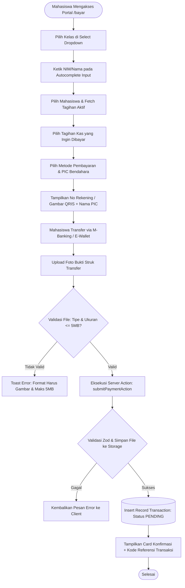
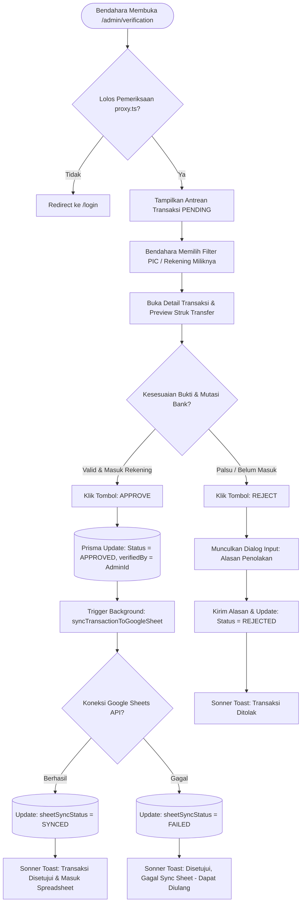
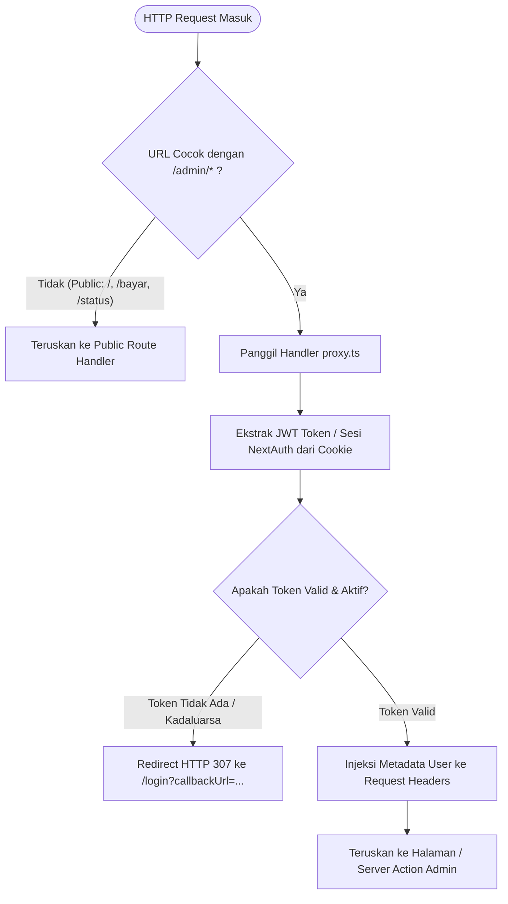
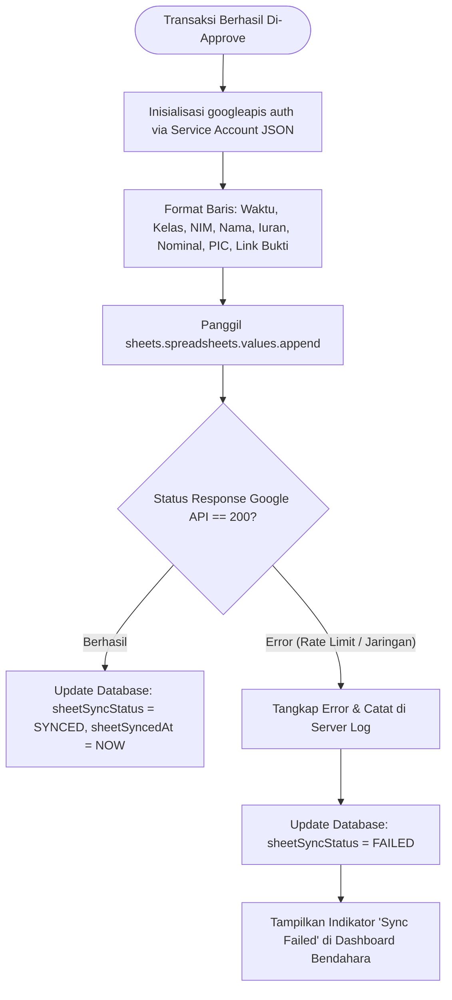

# SYSTEM ARCHITECTURE & TECHNICAL SPECIFICATION
## Proyek: KeuanganAngkatan (Sistem Informasi & Manajemen Keuangan Angkatan Mahasiswa)

---

## 1. HIGH-LEVEL SYSTEM ARCHITECTURE & DIAGRAMS

Sistem KeuanganAngkatan dibangun dengan pendekatan **Monolith Modular Modern** berbasis **Next.js (App Router)** dengan **Server Components & Server Actions**, Prisma ORM, basis data SQLite lokal berkecepatan tinggi, dan integrasi Google Sheets API v4.

```
┌────────────────────────────────────────────────────────────────────────┐
│                        KASANGKATAN WEB PLATFORM                        │
│                                                                        │
│   ┌────────────────────────┐            ┌──────────────────────────┐   │
│   │  PORTAL PUBLIK SISWA   │            │   ADMIN / BENDAHARA      │   │
│   │  • Pilih Kelas & NIM   │            │   • 1-Click Verification │   │
│   │  • Upload Bukti Struk  │            │   • Filter PIC Rekening  │   │
│   │  • Cek Status Kas      │            │   • Master Data & Rekap  │   │
│   └───────────┬────────────┘            └─────────────┬────────────┘   │
│               │ (Public HTTP)                         │ (Auth via      │
│               │                                       │  proxy.ts)     │
│               ▼                                       ▼                │
│   ┌────────────────────────────────────────────────────────────────┐   │
│   │                   NEXT.JS 16 APP ROUTER LAYER                  │   │
│   │  • Public Pages: /bayar, /status, /transparansi                │   │
│   │  • Route Protector: proxy.ts (Guard /admin/*)                  │   │
│   │  • Server Actions (Zod Validation & Business Logic)            │   │
│   └───────────────────────┬───────────────────┬────────────────────┘   │
│                           │                   │                        │
│                           ▼                   ▼                        │
│             ┌─────────────────────────┐  ┌──────────────────────┐      │
│             │     PRISMA ORM v7       │  │ STORAGE SYSTEM       │      │
│             │  (@prisma/adapter-      │  │ public/uploads/      │      │
│             │   better-sqlite3)       │  │ proofs/              │      │
│             └─────────────┬───────────┘  └──────────────────────┘      │
│                           │                                            │
│                           ▼                                            │
│             ┌─────────────────────────┐                                │
│             │   SQLITE DATABASE       │                                │
│             │   (dev.db)              │                                │
│             └─────────────────────────┘                                │
└───────────────────────────┬────────────────────────────────────────────┘
                            │ (Auto-sync saat Approved)
                            ▼
             ┌──────────────────────────────────────────┐
             │         GOOGLE CLOUD PLATFORM            │
             │   Google Sheets API v4 (Service Account) │
             │   • Lembar Rekap Kas Publik Angkatan     │
             └──────────────────────────────────────────┘
```

---

## 2. DETAIL ALUR SISTEM (MERMAID FLOWCHARTS)

### 2.1 Alur Transaksi Pembayaran Mahasiswa (Public Flow)


### 2.2 Alur Verifikasi Multi-Bendahara (Admin 1-Click Verification Flow)


### 2.3 Proteksi Rute Melalui `proxy.ts` (Next.js Modern Architecture)


### 2.4 Alur Sinkronisasi Google Sheets (Google Cloud Service Account)


---

## 3. IMPLEMENTASI AUTENTIKASI NEXTAUTH & ARSITEKTUR `proxy.ts`

### 3.1 Pendekatan Proteksi Modern `proxy.ts`
Pada rilis Next.js modern, route protection tingkat aplikasi dapat diatur melalui handler terpusat `proxy.ts` untuk memfasilitasi abstraksi routing, handling sesi, dan isolasi keamanan sebelum request diproses oleh App Router.

- **Lokasi File:** Berada di root direktori `/home/Akuma/projects/my-bendahara/proxy.ts`.
- **Fungsi Utama:**
  1. Melindungi seluruh sub-path `/admin/*`.
  2. Memeriksa cookie token sesi NextAuth (`authjs.session-token` atau `__Secure-authjs.session-token`).
  3. Memastikan user yang mengakses rute `/login` dialihkan langsung ke `/admin` jika sesi sudah aktif.
  4. Menerapkan header keamanan (Security Headers: `X-Frame-Options`, `X-Content-Type-Options`, `Strict-Transport-Security`).

### 3.2 Desain Konfigurasi NextAuth (`lib/auth.ts`)
Menggunakan **NextAuth.js (Auth.js) v5** dengan strategi **JWT Session**:
- **Provider:** `CredentialsProvider` dengan verifikasi password menggunakan `bcryptjs`.
- **User Record:** Mengambil data dari tabel `Admin` di Prisma.
- **Callbacks:**
  - `jwt`: Membawa `id`, `name`, `email`, dan `role` ke dalam token JWT.
  - `session`: Menginjeksi data token JWT ke dalam objek `session.user` yang dapat diakses di Server Components melalui `auth()`.

---

## 4. DESAIN ANTARMUKA PENGGUNA SHADCN/UI (MODERN & ELEGANT)

Sesuai aturan mutlak proyek, **100% komponen interaktif wajib menggunakan shadcn/ui**. Berikut adalah desain arsitektur antarmuka dan pemetaan komponen per halaman:

### 4.1 Desain Visual & Tema Global
- **Color Tokens:**
  - Background: Neutral Slate 50 (`bg-slate-50` / Dark: `bg-slate-950`)
  - Cards & Containers: Pure White / Slate 900 dengan border `border-slate-200/80`
  - Primary Accent: Indigo-600 (`bg-indigo-600 text-white`)
  - Status Success: Emerald-500 / Emerald-50 (Badge variant / border)
  - Status Pending: Amber-500 / Amber-50
  - Status Danger: Rose-500 / Rose-50
- **Typography:** Inter / Geist dengan `tracking-tight` pada headings.
- **Micro-Interactions:** Hover card elevation (`transition-all hover:shadow-md`), skeleton loading pada form fetch, dan toast notification `sonner`.

### 4.2 Arsitektur Base Layout Login & Dashboard (Mandatory Reference)

Sistem memanfaatkan arsitektur template shadcn yang telah diintegrasikan pada repositori:

1. **Base Layout Login (`app/login/page.tsx` & `components/login-form.tsx`):**
   - Struktur flexbox centering: `min-h-svh flex-col items-center justify-center gap-6 bg-background p-6 md:p-10`.
   - Card container dengan batas lebar: `w-full max-w-sm`.
   - Form controls dibangun menggunakan sistem shadcn `FieldGroup`, `Field`, `FieldLabel`, `Input`, `Button`, `FieldDescription`.
   - Integrasi langsung dengan `loginAdminAction` (NextAuth v5 Credentials).

2. **Base Layout Dashboard Admin (`app/dashboard/page.tsx` & Ekosistem Sidebar):**
   - **Provider Wrapper:** `SidebarProvider` dengan konfigurasi layout token:
     `--sidebar-width: calc(var(--spacing) * 72)` dan `--header-height: calc(var(--spacing) * 12)`.
   - **Shell Struktur:**
     - `<AppSidebar variant="inset" />`: Sidebar navigasi utama dengan menu KasAngkatan, collapse state icon, dan profil user `NavUser`.
     - `<SidebarInset>`: Kontainer utama yang membungkus header dan isi halaman.
     - `<SiteHeader />`: Header atas dengan toggle `SidebarTrigger`, separator vertikal, dan breadcrumb / judul modul aktif.
     - `@container/main`: Kontainer responsif untuk grid layout `SectionCards` (Ringkasan Kas Masuk, Kas Pending, Tagihan Lunas), `ChartAreaInteractive` (Tren Arus Kas), dan `DataTable` (Antrean Verifikasi 1-Klik dan Master Data).

### 4.3 Pemetaan Komponen shadcn/ui per Halaman

| Halaman | Fitur Utama | Komponen shadcn/ui yang Digunakan |
| :--- | :--- | :--- |
| **Landing Page** (`/`) | Hero section, statistik kas singkat, navigasi cepat | `Card`, `Button`, `Badge`, `Separator`, `Tabs` |
| **Form Pembayaran** (`/bayar`) | Pilihan kelas, autocomplete NIM, tagihan, metode bayar, upload | `Card`, `Select`, `Command` (Combobox Autocomplete), `RadioGroup`, `Input`, `Button`, `Badge`, `Dialog` (Preview QRIS) |
| **Cek Status** (`/status`) | Riwayat & status transaksi mahasiswa | `Input`, `Button`, `Table`, `Badge`, `Card`, `Dialog` (Detail Transaksi) |
| **Transparansi** (`/transparansi`) | Rekapitulasi kas publik & pelunasan | `Card`, `Table`, `Badge`, `Progress`, `Tabs`, `Separator` |
| **Login Admin** (`/login`) | Form login bendahara (Base: `app/login/page.tsx`) | `Card`, `FieldGroup`, `Field`, `Input`, `Button`, `Alert`, `sonner` |
| **Admin Dashboard** (`/dashboard` / `/admin`) | Ringkasan kas, grafik, data tabel (Base: `app/dashboard/page.tsx`) | `SidebarProvider`, `AppSidebar`, `SidebarInset`, `SiteHeader`, `SectionCards`, `ChartAreaInteractive`, `DataTable`, `Badge` |
| **Verifikasi Kas** (`/admin/verification`) | Antrean bukti transfer & aksi 1-klik | `Table` (`DataTable`), `Select` (PIC Filter), `Badge`, `Button`, `Dialog` (Preview Struk), `Textarea` (Alasan Reject), `Tooltip` |
| **Master Tagihan** (`/admin/bills`) | Buat & kelola tagihan iuran | `Table`, `Button`, `Dialog`, `Input`, `Textarea`, `Badge`, `DropdownMenu` |
| **Master Rekening** (`/admin/methods`) | Kelola rekening & PIC Bendahara | `Table`, `Button`, `Dialog`, `Input`, `Select`, `Badge`, `Switch` |
| **Master Mahasiswa** (`/admin/students`) | Kelola mahasiswa & kelas | `Table`, `Input` (Search), `Select` (Filter Kelas), `Button`, `Dialog` |

---

## 5. STRUKTUR FOLDER APLIKASI LENGKAP (NEXT.JS APP ROUTER)

```
my-bendahara/
├── actions/                         # Next.js Server Actions (Zod validated)
│   ├── auth.ts                      # Action login/logout bendahara
│   ├── bills.ts                     # CRUD tagihan iuran
│   ├── classes.ts                   # CRUD data kelas mahasiswa
│   ├── payment-methods.ts           # CRUD rekening & PIC bendahara
│   ├── students.ts                  # Autocomplete & CRUD data mahasiswa
│   └── transactions.ts              # Submit bukti, 1-Click Approve, Reject
├── app/
│   ├── (admin)/                     # Route Group Terproteksi (Admin Area)
│   │   ├── admin/
│   │   │   ├── bills/               # Halaman Master Tagihan Kas
│   │   │   │   └── page.tsx
│   │   │   ├── classes/             # Halaman Master Kelas
│   │   │   │   └── page.tsx
│   │   │   ├── methods/             # Halaman Master Metode & PIC
│   │   │   │   └── page.tsx
│   │   │   ├── students/            # Halaman Master Mahasiswa
│   │   │   │   └── page.tsx
│   │   │   ├── verification/        # Halaman Verifikasi 1-Klik
│   │   │   │   └── page.tsx
│   │   │   └── page.tsx             # Dashboard Overview Kas
│   │   ├── layout.tsx               # Admin Layout (Sidebar + Topbar + Auth Guard)
│   ├── (auth)/                      # Route Group Autentikasi
│   │   ├── login/
│   │   │   └── page.tsx             # Form Login Bendahara
│   │   └── layout.tsx
│   ├── (public)/                    # Route Group Akses Publik Mahasiswa
│   │   ├── bayar/                   # Form Pembayaran Mahasiswa
│   │   │   └── page.tsx
│   │   ├── status/                  # Cek Status Pembayaran
│   │   │   └── page.tsx
│   │   ├── transparansi/            # Laporan Transparansi Kas
│   │   │   └── page.tsx
│   │   ├── layout.tsx               # Public Layout (Navbar + Footer Mahasiswa)
│   │   └── page.tsx                 # Landing Page KasAngkatan
│   ├── api/
│   │   ├── auth/[...nextauth]/      # NextAuth Handler Endpoint
│   │   │   └── route.ts
│   │   └── sync-sheets/             # Webhook/Cron Re-sync (Opsional)
│   │       └── route.ts
│   ├── globals.css                  # Tailwind v4 Theme Tokens & Shadcn Variables
│   ├── layout.tsx                   # Root HTML Layout + Toaster Provider
│   └── not-found.tsx                # Custom 404 Page (Shadcn style)
├── components/
│   ├── admin/                       # Komponen Spesifik Dashboard Bendahara
│   │   ├── admin-sidebar.tsx
│   │   ├── bill-form-dialog.tsx
│   │   ├── method-form-dialog.tsx
│   │   ├── proof-preview-dialog.tsx
│   │   └── verification-table.tsx
│   ├── public/                      # Komponen Spesifik Portal Mahasiswa
│   │   ├── payment-card.tsx
│   │   ├── payment-method-selector.tsx
│   │   ├── student-combobox.tsx
│   │   └── upload-receipt-dropzone.tsx
│   ├── shared/                      # Komponen Shared (Public + Admin)
│   │   ├── navbar.tsx
│   │   ├── footer.tsx
│   │   └── status-badge.tsx
│   └── ui/                          # Komponen Murni shadcn/ui
│       ├── alert.tsx
│       ├── badge.tsx
│       ├── button.tsx
│       ├── card.tsx
│       ├── command.tsx
│       ├── dialog.tsx
│       ├── dropdown-menu.tsx
│       ├── input.tsx
│       ├── label.tsx
│       ├── progress.tsx
│       ├── select.tsx
│       ├── separator.tsx
│       ├── table.tsx
│       ├── tabs.tsx
│       ├── textarea.tsx
│       └── tooltip.tsx
├── docs/                            # Arsitektur & Dokumentasi Proyek
├── lib/
│   ├── auth.ts                      # Konfigurasi NextAuth v5 Instance
│   ├── db.ts                        # Prisma Client Singleton Instance
│   ├── google-sheets.ts             # Google Sheets Service Account API
│   ├── upload.ts                    # File Storage & Validation Handler
│   └── utils.ts                     # Helper cn, Currency Formatter, Date Formatter
├── prisma/
│   ├── dev.db                       # Database SQLite
│   ├── schema.prisma                # Skema Database Prisma
│   └── seed.ts                      # Seeder Data Awal (Admin, Kelas, PIC, Siswa)
├── public/
│   └── uploads/
│       ├── methods/                 # Gambar Barcode QRIS Metode Pembayaran
│       └── proofs/                  # File Gambar Bukti Transfer Mahasiswa
├── proxy.ts                         # Handler Proteksi Rute Terpusat Next.js
├── .cursorrules                     # Aturan Coding Baku AI Agent
├── .env.example                     # Contoh Konfigurasi Environment Variables
├── .env.local                       # Kredensial Lokal (Database, Secret, Sheets)
├── package.json
└── tsconfig.json
```

---

## 6. STRATEGI VALIDASI & PENYIMPANAN BERKAS STRUK TRANSFER

Untuk menjaga keamanan server dan kehandalan aplikasi, file bukti transfer ditangani dengan strategi berikut:

1. **Validasi Sisi Klien (Client-Side Check):**
   - Sebelum submit, periksa ukuran file (`file.size <= 5 * 1024 * 1024` bytes / 5 MB).
   - Periksa tipe MIME (`['image/jpeg', 'image/png', 'image/webp'].includes(file.type)`).
   - Render pratinjau instan (*instant thumbnail preview*) menggunakan `URL.createObjectURL(file)` pada komponen shadcn/ui `Card`.

2. **Validasi Sisi Server (Server-Side Pipeline):**
   - File dikirim melalui `FormData` ke Server Action.
   - Pengecekan ulang magic bytes / tipe konten di Server Action.
   - Penamaan file unik untuk mencegah path traversal dan konflik nama:
     `proof-[timestamp]-[crypto.randomUUID().slice(0, 8)].[extension]`
   - Penyimpanan ke direktori lokal: `public/uploads/proofs/`.
   - Path relatif publik disimpan ke field `proofImageUrl` pada tabel `Transaction` (contoh: `/uploads/proofs/proof-1728700000-a1b2c3d4.jpg`).
   - Menyediakan script proteksi direktori atau endpoint penyajian berkas berotorisasi bila diperlukan privasi tingkat lanjut.
